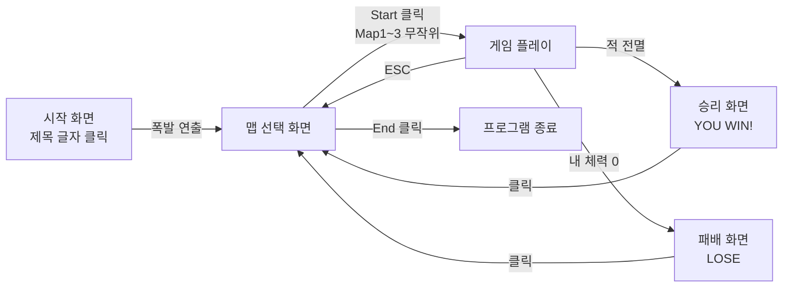
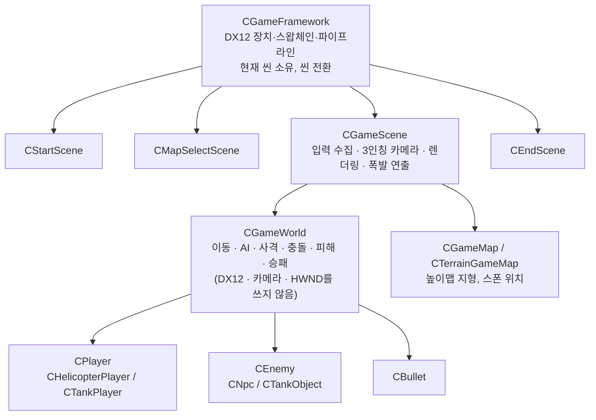

# DirectProject2026 — DirectX12 3인칭 슈팅 게임

DirectX12와 C++로 만든 3인칭(TPS) 슈팅 게임입니다.
지금은 **싱글플레이** 버전이며, 네트워크 프로그래밍 팀 프로젝트에서 이 게임을 **최대 4인 멀티플레이**로 확장합니다.

> 이 문서는 팀원이 "이 게임이 무엇이고, 코드가 어떻게 돌아가는지"를 빠르게 파악하기 위한 안내서입니다.

---

## 목차

1. [게임 소개](#1-게임-소개)
2. [게임 흐름](#2-게임-흐름)
3. [조작법](#3-조작법)
4. [플레이어 기체](#4-플레이어-기체)
5. [적과 맵](#5-적과-맵)
6. [전투 규칙](#6-전투-규칙)
7. [멀티플레이와 관련된 현재 구조](#7-멀티플레이와-관련된-현재-구조)
8. [실행 시 주의](#8-실행-시-주의)
9. [코드 구조](#9-코드-구조)
10. [한 프레임의 흐름](#10-한-프레임의-흐름)
11. [코드 작성 규칙](#11-코드-작성-규칙)

---

## 1. 게임 소개

* 플레이어는 **헬리콥터** 또는 **탱크** 기체를 조종합니다. 기체는 맵에 들어갈 때 무작위로 정해집니다.
* 높이맵 지형 위에서 적을 공격하고, **E 키 쉴드**로 적의 총알을 막습니다.
* 맵 안의 **적을 모두 처치하면 승리**하고, **내 체력이 0이 되면 패배**합니다.
* 화면은 3인칭 카메라로 기체를 뒤에서 따라가며 보여 줍니다.

## 2. 게임 흐름

|씬|파일|하는 일|
|-|-|-|
|시작 화면|`StartScene`|제목 블록 글자를 클릭하면 폭발 연출 후 맵 선택으로 이동|
|맵 선택|`MapSelectScene`|Start -> Map1~3 중 하나로 무작위 진입, End -> 종료|
|게임 플레이|`GameScene` + `GameWorld`|실제 게임 진행|
|결과 화면|`EndScene`|승리(YOU WIN!) / 패배(LOSE) 표시, 클릭하면 맵 선택으로|

## 3. 조작법

|입력|동작|
|-|-|
|`W` `A` `S` `D`|카메라 기준 앞/왼쪽/뒤/오른쪽으로 이동|
|마우스 이동|카메라 회전|
|마우스 왼쪽 버튼 (누르고 있기)|총알 발사 (발사 쿨타임마다 1발)|
|`E`|쉴드 켜기 / 끄기|
|왼쪽 또는 오른쪽 클릭|마우스 잠금 (게임 창에 마우스 고정)|
|`Ctrl`|마우스 잠금 해제|
|`ESC`|맵 선택 화면으로 돌아가기|

* 기체는 **이동하는 방향을 바라보고**, 총알은 **기체가 바라보는 방향**으로 나갑니다.
* 두 기체의 조작은 완전히 같습니다.

## 4. 플레이어 기체

|항목|헬리콥터|탱크|
|-|-|-|
|이동 속도|25|35|
|발사 쿨타임|0.25초 (초당 약 4발)|0.8초|
|체력|100|100|
|총알 발사 위치|기체 앞쪽|포신 끝|
|쉴드|있음|있음|

**쉴드 (두 기체 공통)**

* `E`로 켜면 **최대 3초** 동안 유지되고, 그동안 맞은 적 총알은 피해 없이 사라집니다.
* 3초가 지나거나 `E`로 직접 끄면 **5초 쿨타임**이 시작되고, 쿨타임 동안은 다시 켤 수 없습니다.

## 5. 적과 맵

**적 종류**

|항목|인간형 적 (`Npc`)|탱크형 적 (`Tank`)|
|-|-|-|
|이동 속도|2.5|18|
|체력|50|100|
|발사 쿨타임|0.8초|0.8초|
|피격 판정|부위별 (머리 30 / 몸통 15 / 팔·다리 10)|몸 전체 (총알 피해 10)|

**적 AI (두 종류 공통)**

* **가장 가까운 살아 있는 플레이어**를 목표로 삼고 그쪽을 바라봅니다.
* 거리 120보다 멀면 다가가고, 55보다 가까우면 뒤로 물러납니다.
* 거리 180 이내면 플레이어를 향해 총을 쏩니다.

**맵**

|맵|높이맵 파일|등장 적|
|-|-|-|
|Map1|`HeightMap.raw`|인간형 적 15명|
|Map2|`HeightMap2.raw`|탱크형 적 10대|
|Map3|`HeightMap3.raw`|탱크형 적 3대|

* 모든 맵은 257×257 RAW 높이맵이며, 칸 간격 2.0으로 약 512×512 크기입니다.
* 플레이어는 맵 중앙(0, 0)에서 시작합니다.
* 플레이어와 적 모두 **맵 경계 밖으로 나갈 수 없습니다**. 벽에 비스듬히 부딪히면 벽을 따라 미끄러집니다.

## 6. 전투 규칙

|항목|값|
|-|-|
|총알 속도|180|
|총알 사거리|350 (넘어가면 사라짐)|
|총알 피해|10 (인간형 적은 맞은 부위별 피해 적용)|
|총알 풀 크기|64발 (플레이어와 적이 함께 사용)|

* 총알은 지형에 닿아도 사라집니다.
* 적이 죽으면 그 자리에 블록 폭발 연출이 나옵니다.
* **승리:** 맵의 적을 모두 처치함
* **패배:** 내 체력이 0이 됨 (적 총알 10발)

## 7. 멀티플레이와 관련된 현재 구조

멀티플레이 규칙과 통신 설계는 네트워크 기획서에서 다룹니다. 여기에는 **지금 코드가 어떤 상태인지**만 적습니다.

**이미 갖춰진 것**

* 게임 판정(`CGameWorld`)과 화면 표시(`CGameScene`)가 나뉘어 있습니다. `CGameWorld`는 DX12 렌더링, 카메라, `HWND`를 사용하지 않습니다. (수학 계산에는 DirectXMath를 씁니다)
* 이동 발사 쉴드 입력은 `PlayerInput` 구조체 하나로 모여 있습니다. 단, `W`가 어느 방향인지 정하는 카메라 각도(`thirdPersonYaw`)는 아직 `PlayerInput` 밖에서 따로 넘겨받습니다.
* `CGameWorld`는 플레이어를 목록(`players`)으로 관리합니다.
* 적 AI는 이미 "가장 가까운 살아 있는 플레이어"를 목표로 삼아, 플레이어가 여러 명이어도 그대로 동작합니다.
* 총알은 처음에 만든 64발을 재사용하는 풀 방식이라, 각 총알이 고정된 번호(목록 안의 위치)를 가집니다.

**아직 플레이어 한 명 기준으로 되어 있는 것**

* 이동과 발사 함수가 내 기체 전용입니다. (`UpdateLocalPlayer`, `HandleLocalPlayerFire`)
* 화면에 그리는 플레이어도 내 기체 하나뿐입니다.
* 피격 판정은 플레이어 -> 적, 적 -> 플레이어만 있고, 플레이어끼리는 없습니다.
* 승패 판정은 "적(NPC, TANk) 전멸 = 승리, 내 기체 사망 = 패배"만 있습니다.

## 8. 실행 시 주의

* `HeightMap.raw`, `HeightMap2.raw`, `HeightMap3.raw`가 **실행할 때의 작업 폴더**에 있어야 합니다. `.exe`를 직접 실행할 때는 `.exe` 옆에 복사해 두세요.
* `Shaders.hlsl`은 실행 중에 컴파일되므로 이 파일도 같은 작업 폴더에 있어야 합니다.

## 9. 코드 구조

**계층별 파일**

|계층|파일|역할|
|-|-|-|
|프로그램 진입|`DirectProject2026v1.cpp`|창 생성, 메시지 루프|
|프레임워크|`GameFramework`|DX12 초기화, 루트 시그니처·PSO, 프레임 진행, 씬 전환|
|씬|`SceneBase`, `StartScene`, `MapSelectScene`, `GameScene`, `EndScene`|화면 단위 처리|
|게임 설정|`GameSessionConfig`, `GameMode`, `PlayerType`, `PlayerInput`|한 판의 설정, 규칙, 기체 종류, 한 프레임 입력|
|gameplay|`GameWorld`|게임 판정 전체 (렌더링과 무관)|
|플레이어|`Player`, `HelicopterPlayer`, `TankPlayer`|이동, 발사 쿨타임, 체력, 쉴드, 총구 위치|
|적|`Object`(CEnemy, CHumanoidObject), `Npc`, `Tank`|적 공통 기능과 종류별 모양·수치|
|오브젝트|`Object`(CGameObject), `Bullet`, `Collider`|기본 오브젝트(위치·회전·자식), 총알, 충돌 박스|
|맵|`GameMap`, `TerrainGameMap`|맵 인터페이스, RAW 높이맵 지형, 스폰 위치|
|그래픽|`Mesh`, `Camera`, `ThirdPersonCameraProfile`, `Shaders.hlsl`|정점·인덱스 버퍼, 카메라, 기체별 카메라 설정, 셰이더|
|공통|`stdafx`, `Timer`, `targetver`, `Resource`|공통 헤더·수학 도우미, 타이머, VS 기본 파일|

**셰이더 루트 상수**

|레지스터|내용|
|-|-|
|`b0`|월드 행렬|
|`b1`|뷰 행렬 + 투영 행렬|
|`b2`|색상|

## 10. 한 프레임의 흐름

게임은 아래 6단계를 **계속 반복**합니다.

|순서|하는 일|실제 함수|
|-|-|-|
|① 시간 재기|지난 프레임 이후 몇 초 지났는지(`deltaTime`) 잽니다. 이동 거리 = 속도 × `deltaTime`이라서 컴퓨터가 빠르든 느리든 같은 속도로 움직입니다.|`CGameTimer::Tick`|
|② 입력 모으기|지금 눌린 키와 마우스 움직임을 `PlayerInput` 하나로 묶습니다.|`CGameScene::ProcessInput`|
|③ 게임 진행|그 입력대로 게임을 진행합니다. (아래 표)|`CGameScene::AnimateObjects`|
|④ 화면 전환 확인|승패가 났거나 `ESC`를 눌렀으면 다른 화면(씬)으로 바꿉니다.|`CGameFramework::CheckSceneChange`|
|⑤ 그리기|지금 상태를 그립니다. 지형 -> 내 기체 -> 적 -> 총알 -> 폭발 블록 순서이며, 내 기체와 적은 카메라에 안 보이면 건너뜁니다.|`CGameScene::RenderDirect`|
|⑥ 모니터에 표시|다 그린 그림을 화면에 내보냅니다.|`Present`|

**③ 게임 진행 자세히**

함수 이름이 `CGameWorld`로 시작하면 **게임 규칙(판정)**, `CGameScene`으로 시작하면 **보여 주기(화면)** 담당입니다.

|순서|하는 일|실제 함수|
|-|-|-|
|1|마우스 움직임만큼 카메라를 돌립니다.|`CGameScene::ApplyThirdPersonLookInput`|
|2|내 기체: 쉴드 켜기/끄기 -> WASD 이동 -> 맵 밖이면 되돌림 -> 지형 높이에 맞춤|`CGameWorld::UpdateLocalPlayer`|
|3|좌클릭 중이고 쿨타임이 끝났으면 총알을 한 발 쏩니다.|`CGameWorld::HandleLocalPlayerFire`|
|4|쉴드 상태를 기체 색으로 보여 주고, 카메라를 기체 뒤로 옮깁니다.|`CGameScene::UpdateShieldVisual`, `CGameScene::UpdateThirdPersonCamera`|
|5|적: 가장 가까운 플레이어 쪽으로 움직이고, 사거리 안이면 쏩니다.|`CGameWorld::UpdateEnemies`|
|6|총알: 앞으로 날아가고, 사거리를 넘거나 땅에 닿으면 사라집니다.|`CGameWorld::UpdateBullets`|
|7|총알이 맞았는지 확인하고 체력을 깎습니다.|`CGameWorld::CheckBulletHits`|
|8|이번 프레임에 죽은 적 자리에 폭발 연출을 띄웁니다.|`CGameScene::StartEnemyExplosion`, `CGameScene::UpdateEnemyExplosions`|
|9|승패를 확인합니다. 결과가 나오면 ④에서 결과 화면으로 넘어갑니다.|`CGameWorld::UpdateGameResult`|
